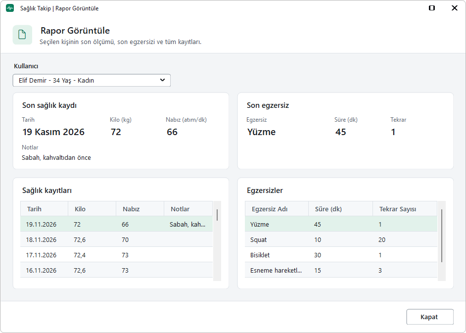

# Sağlık Takip Uygulaması

Bu uygulama, kullanıcıların sağlık verilerini (kilo, nabız vb.) kaydetmek, egzersiz planları oluşturmak ve bu bilgileri raporlamak amacıyla geliştirilmiştir.

## 🔧 Kurulum Talimatları

Gereksinimler: .NET 10 SDK ve SQL Server (Express yeterli).

1. **Bağlantı ayarı**  
   `src/SaglikTakip.UI/appsettings.example.json` dosyasını aynı klasöre `appsettings.json` adıyla kopyalayıp bağlantı bilgisini girin
   (ya da `dotnet user-secrets set ConnectionStrings:SaglikTakip "<bağlantı>" --project src/SaglikTakip.UI` veya
   `SAGLIKTAKIP_CONNECTION` ortam değişkeni).

2. **Çalıştırma**  
   `dotnet run --project src/SaglikTakip.UI`  
   Veritabanı ilk açılışta EF Core migration'larıyla oluşturulur. Eski sürümün oluşturduğu bir veritabanı
   kayıtları korunarak yerinde yükseltilir.

3. **Testler**  
   `dotnet test` (SQL Server gerektiren testleri atlamak için `SAGLIKTAKIP_SKIP_SQL_TESTS=1`).

## 🧭 Ana Menü Özellikleri

- **Kullanıcı Ekle**: Yeni kullanıcı bilgisi ekleme ekranı.
- **Sağlık Kaydı Ekle**: Kilo, nabız gibi sağlık verilerini kullanıcıya özel olarak ekleme ekranı.
- **Egzersiz Planla**: Kullanıcılara özel egzersiz programı oluşturma alanı.
- **Rapor Görüntüle**: Kullanıcının geçmiş sağlık ve egzersiz verilerini görüntüleme ekranı.
- **Çıkış**: Uygulamadan güvenli çıkış yapılmasını sağlar.

## 👤 1. Kullanıcı Ekleme

Yeni bir kullanıcı eklemek için:

- **Ad**: Kullanıcının adını girin (Örn: `Ayberk`)
- **Yaş**: Kullanıcının yaşını girin (Örn: `19`)
- **Cinsiyet**: Kadın / Erkek / Diğer seçeneklerinden birini seçin.
- **Kaydet** butonuna tıklayın.

Kullanıcı başarıyla veritabanına kaydedilecektir.

## 📋 2. Sağlık Kaydı Ekleme

Kullanıcının sağlık bilgilerini kaydetmek için:

- **Kullanıcı Seç**: Kayıt eklenecek kullanıcıyı seçin.
- **Tarih**: Takip tarihini belirtin.
- **Kilo**: Kilo bilgisini girin.
- **Nabız**: Nabız değerini girin.
- **Notlar**: Ek açıklamalar (isteğe bağlı).
- **Kaydet** butonuna basın.

Kayıt başarıyla eklenir ve kullanıcı geçmişine kaydedilir.

## 🏃 3. Egzersiz Planlama

Kullanıcıya özel egzersiz planı oluşturmak için:

- **Kullanıcı Seç**: Plan oluşturulacak kullanıcıyı seçin.
- **Egzersiz Adı**: Örn: `Koşu`
- **Süre (dk)**: Egzersiz süresi girin.
- **Tekrar**: Kaç tekrar yapılacağını belirtin.
- **Kaydet** butonuna tıklayın.

Veriler, kullanıcıya özel egzersiz planı olarak saklanacaktır.

## 📊 4. Rapor Görüntüleme

Kullanıcının geçmiş sağlık ve egzersiz kayıtlarını incelemek için:

- **Kullanıcı Seç**: Raporunu görüntülemek istediğiniz kullanıcıyı seçin.

Rapor 2 bölümde sunulur:

- **Sağlık Kayıtları**: Kilo, nabız gibi sağlık verileri listelenir.
- **Egzersizler**: Kullanıcının uyguladığı egzersiz planları gösterilir.

## 🖼️ Ekran Görüntüleri

### Ana Sayfa

### Kullanıcı (Hasta) Ekle

### Sağlık Bilgileri Ekle

### Egzersiz Ekle

### Rapor Görüntüle

## 🗂️ Proje Hakkında

Bu proje, bireylerin sağlık takibini kolaylaştırmak ve düzenli olarak egzersiz yapmalarını desteklemek amacıyla hazırlanmıştır. Eğitim, staj veya bireysel projelerinizde kullanabilirsiniz.
