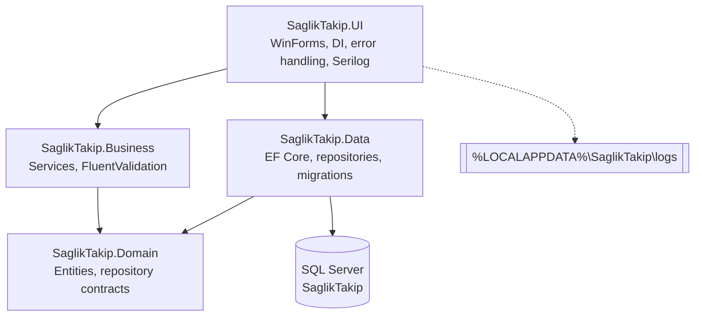

# 🩺 Sağlık Takip - Health Tracking Application (C# & SQL Server)

🇬🇧 **English** · 🇹🇷 [Türkçe](README.tr.md)

A Windows Forms application built with .NET 10 and SQL Server for recording users' health data (weight,
pulse, notes), planning exercises and reporting this history. The code is split into Domain, Business,
Data and UI layers; database access uses EF Core, and the database is created and migrated automatically
on startup.

> The application's user interface is in Turkish. Screen and button names below are given with their
> Turkish labels followed by an English translation, e.g. "Sağlık Kaydı Ekle" (Add Health Record).

---

## 📦 Features

- ✅ **Users** ("Kullanıcı Ekle", Add User): name, age and gender ("Kadın" / "Erkek" / "Diğer", Female / Male / Other).
- ✅ **Health records** ("Sağlık Kaydı Ekle", Add Health Record): date, weight, pulse and optional notes for the
  selected user ("Kullanıcı Seç", Select User).
- ✅ **Exercises** ("Egzersiz Planla", Plan Exercise): exercise name, duration in minutes and repetitions for the
  selected user.
- ✅ **Report** ("Rapor Görüntüle", View Report): the selected user's health records and exercises, newest first,
  with the latest values summarised. Only the report of the most recently selected user is ever shown.
- ✅ **Input validation**: central FluentValidation validators with Turkish messages. Age 0-150, weight 1-200 kg,
  pulse 1-250, record date between 1900-01-01 and today (no future dates), duration 0-1440 minutes,
  repetitions 0-1000 (at least one of them above zero), names required and at most 100 characters, notes at
  most 500 characters. Text is trimmed; blank notes are stored as no notes (`NULL`).
- ✅ **Safe saving**: "Kaydet" (Save) buttons ignore repeated clicks while a save is still pending.
- ✅ **Automatic database setup**: pending EF Core migrations are applied on startup; a database created by the
  original application is upgraded in place and keeps its data.
- ✅ **Error handling and logging**: unexpected errors are caught globally and shown as short Turkish messages;
  technical details go to a daily log file that never contains health or personal data.

---

## 🧰 Tech Stack

| Area | Used |
|---|---|
| Platform | .NET 10 (`net10.0-windows` UI, `net10.0` libraries) |
| UI | Windows Forms |
| Data access | Entity Framework Core 10 (SQL Server provider) |
| Database | Microsoft SQL Server (Express or LocalDB is enough) |
| Validation | FluentValidation |
| Configuration / DI | Microsoft.Extensions.Configuration (JSON, user secrets, environment), Microsoft.Extensions.DependencyInjection |
| Logging | Serilog (file sink, daily rolling) |
| Testing | xUnit v3, Moq, EF Core SQLite (in-memory), optional real SQL Server tests |
| CI | GitHub Actions (`.github/workflows/ci.yml`) |

---

## 🗂️ Project Structure

```text
SaglikTakip/
├── src/
│   ├── SaglikTakip.Domain/     # Entities (User, HealthRecord, Exercise, UserReport) and repository contracts
│   ├── SaglikTakip.Business/   # UserService, HealthRecordService, ExerciseService, ReportService, Validation/ (FluentValidation)
│   ├── SaglikTakip.Data/       # EF Core DbContext, configurations, Migrations/, legacy upgrade, repositories
│   └── SaglikTakip.UI/         # WinForms screens, Infrastructure/ (errors, logging, save guard), Program.cs (composition root)
├── tests/
│   ├── SaglikTakip.Business.Tests/  # Validator and service unit tests (Moq, in-memory fakes)
│   ├── SaglikTakip.Data.Tests/      # Repository and service tests on SQLite; legacy upgrade tests (SQL Server)
│   └── SaglikTakip.UI.Tests/        # Configuration, error message, log, save guard and report tests (no windows shown)
├── docs/THREAT_MODEL.md        # Threat model
├── .github/workflows/ci.yml    # Build, test and release workflow
├── screenshots/                # README screenshots
├── CHANGELOG.md
└── SaglikTakip.sln
```



The UI references Data only to register dependencies at startup; forms work through the Business services.
All database access is asynchronous and parameterised. The provider is configured through DI (`AddDataAccess`),
so tests can use SQLite in-memory.

---

## 🛠️ Setup and Usage

### Requirements

- .NET 10 SDK (Windows)
- SQL Server (Express or LocalDB is enough)

### 1. Configuration

Provide a connection string named `SaglikTakip`. Any of the following works (later ones override earlier ones):

1. **`appsettings.json`**: copy `src/SaglikTakip.UI/appsettings.example.json` to `appsettings.json` in the same
   folder and edit `ConnectionStrings:SaglikTakip`. `appsettings.json` is git-ignored.

   ```json
   {
     "ConnectionStrings": {
       "SaglikTakip": "Server=localhost\\SQLEXPRESS;Database=SaglikTakip;Trusted_Connection=True;TrustServerCertificate=True;"
     }
   }
   ```

2. **User secrets**:

   ```powershell
   dotnet user-secrets set "ConnectionStrings:SaglikTakip" "<connection string>" --project src/SaglikTakip.UI
   ```

3. **Environment variable** `ConnectionStrings__SaglikTakip`.
4. **Environment variable** `SAGLIKTAKIP_CONNECTION` (highest priority).

> Inside JSON the `\` in `localhost\SQLEXPRESS` is written as `\\`. `TrustServerCertificate=True` is meant for a
> local development server only.

If no connection string is found, the application shows a Turkish message explaining these options and exits.

### 2. Running

```powershell
dotnet build -c Release
dotnet run --project src/SaglikTakip.UI
```

The database is created on first start and filled with fictional sample data; pending migrations are applied
automatically on every start, so no manual `dotnet ef database update` is needed.

### 3. Upgrading an existing database

A database created by the original application (tables `Kullanicilar`, `SaglikKayitlari`, `Egzersizler`
without a migrations history) is upgraded in place on first start: existing rows and identity values are kept,
the missing constraints, indexes and row versions are added and the migration is recorded as applied, so no
sample data is inserted. The upgrade runs in one transaction under an application lock (`sp_getapplock`, whose
return code is checked) and is safe to repeat. If existing rows break the new rules (for example a pulse of
300), the upgrade stops before changing anything and reports only counts, never row contents.

Take a backup of the database before the first start with the new version.

### 4. Migrations

```powershell
dotnet tool restore
dotnet ef migrations list --project src/SaglikTakip.Data
dotnet ef migrations add <Name> --project src/SaglikTakip.Data --output-dir Persistence/Migrations
```

The design-time factory reads `SAGLIKTAKIP_CONNECTION` and otherwise uses a local SQL Server Express instance.

### 5. Logs

Logs are written to `%LOCALAPPDATA%\SaglikTakip\logs\sagliktakip-YYYYMMDD.log`, one file per day, and the last
30 files are kept. The folder is outside the repository. Error entries contain only exception types, error
codes and the method names of the stack trace (no file paths). Exception messages, measurement values
(weight, pulse), notes and user names are never written to the log.

---

## 🔐 Security

See [docs/THREAT_MODEL.md](docs/THREAT_MODEL.md) for the threat model.

- Health data is sensitive personal data. The application stores it only in the configured SQL Server
  database; it is not sent anywhere else and not written to log files.
- Connection strings are kept out of the repository (`appsettings.json` is ignored; user secrets and environment
  variables are supported).
- All queries go through EF Core; there is no hand-built SQL with user input.
- Business rules are enforced in the Business layer and backed by database constraints (check constraints on
  age, gender, weight, pulse, duration and repetitions; restrict foreign keys).
- Users only see Turkish messages; raw exception text is never shown.
- The application has no sign-in or roles: anyone who can start it can read and change all data. Database access
  is controlled by the SQL Server account in the connection string.

---

## 🖥️ Screenshots

### "Ana Sayfa" (Main menu)


### "Kullanıcı Ekle" (Add user)


### "Sağlık Kaydı Ekle" (Add health record)


### "Egzersiz Planla" (Plan exercise)


### "Rapor Görüntüle" (View report)


---

## 🧪 Testing

### Manual testing

1. Add a user on "Kullanıcı Ekle" (Add User); try an age of 151 or no gender.
2. Add a health record on "Sağlık Kaydı Ekle" (Add Health Record); try a future date or a pulse of 0.
3. Add an exercise on "Egzersiz Planla" (Plan Exercise); try a duration and repetition count of 0.
4. Open "Rapor Görüntüle" (View Report) and switch quickly between users: only the last selected user's report stays.
5. Stop SQL Server and check that a friendly Turkish error is shown and the details land in the log file.

### Automated tests

```powershell
dotnet test -c Release
```

| Project | Type | Scope | Result (`-c Release`, SQL tests skipped) |
|---|---|---|---|
| `tests/SaglikTakip.Business.Tests` | Unit | Validator limits (age 0/150, weight 1/200, pulse 1/250, future date, duration, repetitions, lengths), Turkish messages, services with strict Moq mocks | 85 passed |
| `tests/SaglikTakip.Data.Tests` | Integration | Repositories and services on SQLite in-memory (`Data Source=:memory:`), check constraints and foreign keys; legacy upgrade and upgrade lock on SQL Server | 19 passed, 4 skipped |
| `tests/SaglikTakip.UI.Tests` | Unit | Example configuration, Turkish error messages, log content and files, save guard, latest-wins report loading | 13 passed |

The skipped tests need SQL Server. They use throw-away databases on the server in `SAGLIKTAKIP_TEST_SQLSERVER`
(default: local SQL Express with Windows authentication) and are skipped when `SAGLIKTAKIP_SKIP_SQL_TESTS=1` is
set or no server is reachable. The temporary databases are dropped afterwards.

```powershell
$env:SAGLIKTAKIP_SKIP_SQL_TESTS = "1"; dotnet test -c Release
```

On SQLite the schema is created from the model (`EnsureCreated`) instead of migrations, and row versions are not
generated. The UI tests create forms without showing them, so no window opens.

---

## 🚀 CI and Release

`.github/workflows/ci.yml` runs on pushes to `main`, on pull requests and on `v*` tags (Windows, .NET 10):

1. **Build:** `dotnet build -c Release`
2. **Test:** `dotnet test -c Release` (SQL Server tests skipped)
3. **Release (only on `v*` tags):** a framework-dependent win-x64 build is published and uploaded as the
   workflow artifact `SaglikTakip-<tag>-win-x64.zip`

To produce the same build locally:

```powershell
dotnet publish src/SaglikTakip.UI -c Release -r win-x64 --self-contained false -o ./publish
```

The target machine needs the .NET 10 Desktop Runtime. Put `appsettings.json` next to `SaglikTakip.exe` or set
`SAGLIKTAKIP_CONNECTION`.

---

## 👨‍💻 Developer Notes

- See [CHANGELOG.md](CHANGELOG.md) for the version history.
- `Program.cs` is the composition root: configuration, DI, logging and the global `ThreadException` /
  `UnhandledException` handlers are set up there.
- Business rule violations raise `BusinessRuleException` with a Turkish message, which the UI shows as a warning.
- Validators (`UserInputValidator`, `HealthRecordInputValidator`, `ExerciseInputValidator`) live in
  `SaglikTakip.Business/Validation` and stop at the first failure, so the user sees one message at a time.
- New save or delete buttons should go through `RunExclusiveAsync` (`ExclusiveOperation`), and loads triggered by
  a selection should use `RequestSequence` so only the latest response is shown.

---

## 🗂️ About the Project

This project was built to make personal health tracking easier and to support regular exercise. You can use it in
educational, internship or personal projects.
