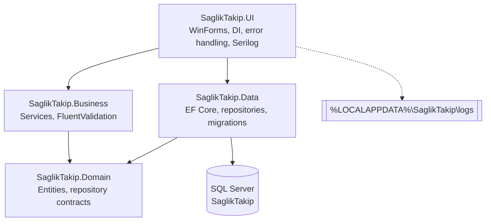
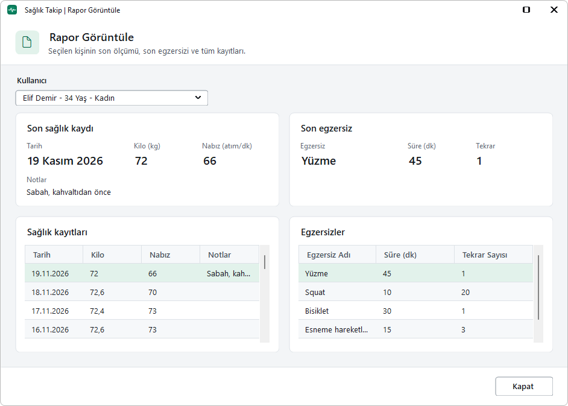

# 🩺 Sağlık Takip - Sağlık Takip Uygulaması (C# & SQL Server)

🇬🇧 [English](README.md) · 🇹🇷 **Türkçe**

Kullanıcıların sağlık verilerini (kilo, nabız, notlar) kaydetmek, egzersiz planlamak ve bu geçmişi raporlamak
için .NET 10 ve SQL Server ile geliştirilmiş bir Windows Forms uygulaması. Kod Domain, Business, Data ve UI
katmanlarına ayrılmıştır; veritabanı erişimi EF Core ile yapılır ve veritabanı açılışta otomatik olarak
oluşturulup güncellenir.

> Uygulamanın arayüzü Türkçedir. İngilizce README'de ekran ve düğme adları "Türkçe etiket (English)" biçiminde,
> örneğin "Sağlık Kaydı Ekle" (Add Health Record) olarak verilir.

---

## 📦 Özellikler

- ✅ **Kullanıcılar** ("Kullanıcı Ekle"): ad, yaş ve cinsiyet ("Kadın" / "Erkek" / "Diğer").
- ✅ **Sağlık kayıtları** ("Sağlık Kaydı Ekle"): seçilen kullanıcı ("Kullanıcı Seç") için tarih, kilo, nabız ve
  isteğe bağlı notlar.
- ✅ **Egzersizler** ("Egzersiz Planla"): seçilen kullanıcı için egzersiz adı, dakika cinsinden süre ve tekrar sayısı.
- ✅ **Rapor** ("Rapor Görüntüle"): seçilen kullanıcının sağlık kayıtları ve egzersizleri en yeniden eskiye,
  son değerlerin özetiyle. Her zaman yalnızca en son seçilen kullanıcının raporu gösterilir.
- ✅ **Trend grafikleri** ("Trend Grafikleri"): seçilen kullanıcının kilo veya nabzı, bir tarih aralığında GDI+
  ile çizilir (üçüncü parti grafik paketi yok). Aynı gündeki birden fazla ölçüm ortalamalarıyla gösterilir; özet,
  her bir ölçümün sayısını, en düşük, en yüksek ve ortalama değerini ve 1-90 günlük geriye dönük hareketli ortalamayı
  verir (pencere dolana kadar boştur). Hedef sınırları çizgi olarak çizilir, sınır dışı ölçümler listelenir.
- ✅ **Hedefler ve uyarı eşikleri** ("Hedefler"): kullanıcı başına isteğe bağlı hedef kilo ve başlangıç kilosu,
  kilo aralığı ve nabız aralığı. Sınırlar dahildir (sınıra eşit değer aralık içindedir). Sınır dışı bir ölçüm
  kaydedilince uyarı gösterilir; ilerleme başlangıç kilosundan hedef kiloya doğru hesaplanır (%0-100, kilo verme ve
  alma için).
- ✅ **Hatırlatıcılar** ("Hatırlatıcılar"): dönemsel ölçüm veya egzersiz hatırlatıcıları (her N saat, gün veya hafta)
  veritabanında saklanır. Uygulama açıkken dakikada bir denetlenir ve bildirim alanından, odağı hiç almayan bir
  balonla duyurulur. Uygulama kapalıyken zamanı gelen hatırlatıcılar açılışta kaçırılan tekrar sayısıyla listelenir;
  "Tamamlandı" hatırlatıcıyı şimdiden sonraki ilk zamanına taşır.
- ✅ **Haftalık / aylık rapor** ("Dönem Raporu"): seçilen aralığın (son 7 veya 30 gün, bu ay, geçen ay ya da herhangi
  bir aralık) özeti CSV (BOM'lu UTF-8, `;` ayraçlı, formül enjeksiyonuna karşı korumalı) veya yazdırılabilir HTML
  sayfası olarak dışa aktarılır; tarayıcıdaki "Yazdır > PDF olarak kaydet" ile PDF elde edilir.
- ✅ **Girdi doğrulama**: Türkçe mesajlı merkezi FluentValidation doğrulayıcıları. Yaş 0-150, kilo 1-200 kg,
  nabız 1-250, kayıt tarihi 01.01.1900 ile bugün arasında (ileri tarih olamaz), süre 0-1440 dakika, tekrar
  0-1000 (en az biri sıfırdan büyük), adlar zorunlu ve en fazla 100 karakter, notlar en fazla 500 karakter.
  Metinler kırpılır; boş notlar not yok (`NULL`) olarak saklanır.
- ✅ **Güvenli kayıt**: kaydetme, silme, oluşturma ve dışa aktarma düğmeleri önceki işlem sürerken gelen tekrar
  tıklamaları yok sayar; seçime göre veri yükleyen ekranlar yalnızca en son seçimin yanıtını gösterir.
- ✅ **Otomatik veritabanı kurulumu**: bekleyen EF Core migration'ları açılışta uygulanır; eski uygulamanın
  oluşturduğu bir veritabanı verileri korunarak yerinde yükseltilir.
- ✅ **Hata yönetimi ve günlük**: beklenmeyen hatalar genel olarak yakalanır ve kısa Türkçe mesajlarla gösterilir;
  teknik ayrıntılar sağlık veya kişisel veri içermeyen günlük dosyasına yazılır.

---

## 🧰 Teknolojiler

| Alan | Kullanılan |
|---|---|
| Platform | .NET 10 (UI için `net10.0-windows`, kütüphaneler için `net10.0`) |
| Arayüz | Windows Forms; grafikler GDI+ ile çizilir |
| Raporlar | Uygulamanın kendi yazdığı CSV ve tek dosyalık yazdırılabilir HTML (PDF kütüphanesi yok) |
| Veri erişimi | Entity Framework Core 10 (SQL Server sağlayıcısı) |
| Veritabanı | Microsoft SQL Server (Express veya LocalDB yeterli) |
| Doğrulama | FluentValidation |
| Yapılandırma / DI | Microsoft.Extensions.Configuration (JSON, user secrets, ortam değişkenleri), Microsoft.Extensions.DependencyInjection |
| Günlük | Serilog (dosya, günlük dönen) |
| Test | xUnit v3, Moq, EF Core SQLite (bellek içi), isteğe bağlı gerçek SQL Server testleri |
| CI | GitHub Actions (`.github/workflows/ci.yml`) |

---

## 🗂️ Proje Yapısı

```text
SaglikTakip/
├── src/
│   ├── SaglikTakip.Domain/     # Varlıklar (User, HealthRecord, Exercise, HealthGoal, Reminder, UserReport) ve repository sözleşmeleri
│   ├── SaglikTakip.Business/   # Servisler (kullanıcı, kayıt, egzersiz, rapor, trend, hedef, hatırlatıcı, dönem raporu),
│   │                           # Insights/ (trend, hedef ve hatırlatıcı kuralları), Reporting/ (CSV, HTML), Validation/ (FluentValidation)
│   ├── SaglikTakip.Data/       # EF Core DbContext, yapılandırmalar, Migrations/, eski veritabanı yükseltme, repository'ler
│   └── SaglikTakip.UI/         # WinForms ekranları, Infrastructure/ (hata, günlük, kayıt koruması, grafik, hatırlatıcı izleyici), Program.cs (composition root)
├── tests/
│   ├── SaglikTakip.Business.Tests/  # Doğrulayıcı ve servis birim testleri (Moq, bellek içi sahteler)
│   ├── SaglikTakip.Data.Tests/      # SQLite üzerinde repository ve servis testleri; eski veritabanı yükseltme testleri (SQL Server)
│   └── SaglikTakip.UI.Tests/        # Yapılandırma, hata mesajı, günlük, kayıt koruması, son isteğin kazandığı yükleme, grafik ve hatırlatıcı testleri (pencere açılmaz)
├── docs/THREAT_MODEL.md        # Tehdit modeli
├── .github/workflows/ci.yml    # Derleme, test ve sürüm iş akışı
├── screenshots/                # README ekran görüntüleri
├── CHANGELOG.tr.md
└── SaglikTakip.sln
```



UI, Data katmanına yalnızca açılışta bağımlılıkları kaydetmek için başvurur; formlar Business servisleri üzerinden
çalışır. Tüm veritabanı erişimi asenkron ve parametrelidir. Sağlayıcı DI ile yapılandırılır (`AddDataAccess`),
böylece testler bellek içi SQLite kullanabilir.

---

## 🛠️ Kurulum ve Kullanım

### Gereksinimler

- .NET 10 SDK (Windows)
- SQL Server (Express veya LocalDB yeterli)

### 1. Yapılandırma

`SaglikTakip` adlı bir bağlantı dizesi verin. Aşağıdakilerin herhangi biri çalışır (sonrakiler öncekileri ezer):

1. **`appsettings.json`**: `src/SaglikTakip.UI/appsettings.example.json` dosyasını aynı klasöre `appsettings.json`
   adıyla kopyalayın ve `ConnectionStrings:SaglikTakip` değerini düzenleyin. `appsettings.json` git tarafından yok sayılır.

   ```json
   {
     "ConnectionStrings": {
       "SaglikTakip": "Server=localhost\\SQLEXPRESS;Database=SaglikTakip;Trusted_Connection=True;TrustServerCertificate=True;"
     }
   }
   ```

2. **User secrets**:

   ```powershell
   dotnet user-secrets set "ConnectionStrings:SaglikTakip" "<bağlantı dizesi>" --project src/SaglikTakip.UI
   ```

3. **Ortam değişkeni** `ConnectionStrings__SaglikTakip`.
4. **Ortam değişkeni** `SAGLIKTAKIP_CONNECTION` (en yüksek öncelik).

> JSON içinde `localhost\SQLEXPRESS` içindeki `\`, `\\` olarak yazılır. `TrustServerCertificate=True` yalnızca yerel
> geliştirme sunucusu içindir.

Bağlantı dizesi bulunamazsa uygulama bu seçenekleri açıklayan Türkçe bir mesaj gösterip kapanır.

### 2. Çalıştırma

```powershell
dotnet build -c Release
dotnet run --project src/SaglikTakip.UI
```

Veritabanı ilk açılışta oluşturulur ve kurgusal örnek verilerle doldurulur; bekleyen migration'lar her açılışta
otomatik uygulanır, elle `dotnet ef database update` çalıştırmak gerekmez.

### 3. Mevcut veritabanını yükseltme

Eski uygulamanın oluşturduğu bir veritabanı (migration geçmişi olmayan `Kullanicilar`, `SaglikKayitlari`,
`Egzersizler` tabloları) ilk açılışta yerinde yükseltilir: mevcut satırlar ve kimlik değerleri korunur, eksik
kısıtlar, indeksler ve satır sürümleri eklenir ve migration uygulanmış olarak işaretlenir; örnek veri eklenmez.
Yükseltme tek bir transaction içinde, bir uygulama kilidi altında (`sp_getapplock`, dönüş kodu denetlenir) çalışır
ve tekrar çalıştırılması güvenlidir. Mevcut satırlar yeni kuralları bozuyorsa (örneğin 300 nabız), yükseltme hiçbir
şeyi değiştirmeden durur ve satır içeriklerini değil yalnızca sayıları bildirir.

Yeni sürümle ilk açılıştan önce veritabanının yedeğini alın.

Hedefler (`Hedefler`) ve hatırlatıcılar (`Hatirlaticilar`) kendi migration'larıyla (`AddHealthGoals`,
`AddReminders`) eklenen yeni tablolardır; mevcut tablolar değişmez. Yükseltilen eski bir veritabanı bu tabloları
yükseltmenin hemen ardından normal migration adımıyla alır.

### 4. Migration'lar

```powershell
dotnet tool restore
dotnet ef migrations list --project src/SaglikTakip.Data
dotnet ef migrations add <Ad> --project src/SaglikTakip.Data --output-dir Persistence/Migrations
```

Tasarım zamanı fabrikası `SAGLIKTAKIP_CONNECTION` değişkenini okur, yoksa yerel SQL Server Express örneğini kullanır.

### 5. Günlükler

Günlükler `%LOCALAPPDATA%\SaglikTakip\logs\sagliktakip-YYYYMMDD.log` dosyalarına, her gün için bir dosya olacak
şekilde yazılır ve son 30 dosya saklanır. Klasör deponun dışındadır. Hata kayıtları yalnızca istisna türlerini,
hata kodlarını ve yığın izindeki metot adlarını (dosya yolu olmadan) içerir. İstisna mesajları, ölçüm değerleri
(kilo, nabız), notlar ve kullanıcı adları günlüğe hiçbir zaman yazılmaz. Hatırlatıcı denetimleri yalnızca zamanı
gelen hatırlatıcı sayısını, dışa aktarmalar yalnızca biçimi günlüğe yazar; dosya yolu veya hatırlatıcı başlıkları
yazılmaz.

---

## 🔐 Güvenlik

Tehdit modeli için [docs/THREAT_MODEL.md](docs/THREAT_MODEL.md) dosyasına bakın.

- Sağlık verisi özel nitelikli kişisel veridir. Uygulama bu veriyi yalnızca yapılandırılan SQL Server
  veritabanında saklar; başka bir yere göndermez ve günlük dosyalarına yazmaz.
- Bağlantı dizeleri depo dışında tutulur (`appsettings.json` yok sayılır; user secrets ve ortam değişkenleri
  desteklenir).
- Tüm sorgular EF Core üzerinden gider; kullanıcı girdisiyle elle oluşturulan SQL yoktur.
- İş kuralları Business katmanında uygulanır ve veritabanı kısıtlarıyla desteklenir (yaş, cinsiyet, kilo, nabız,
  süre ve tekrar için check kısıtları; silmeyi engelleyen yabancı anahtarlar).
- Kullanıcı yalnızca Türkçe mesajlar görür; ham istisna metni hiçbir zaman gösterilmez.
- Dışa aktarılan raporlar sağlık verisi içerir ve yalnızca kullanıcının seçtiği yere kaydedilir. `=`, `+`, `-`,
  `@`, sekme veya satır başı ile başlayan CSV hücrelerinin başına `'` eklenir, böylece hesap tablosu programları
  bunları formül olarak çalıştırmaz. HTML raporu her değeri kodlar, betik içermez ve `default-src 'none'` içerik
  güvenliği politikası tanımlar. İkisi de hedef klasörde geçici bir dosyaya yazılıp yerine taşınır; başarısız bir
  dışa aktarma yarım dosya bırakmaz. Önerilen dosya adları yalnızca tarih aralığını içerir.
- Uygulamada oturum açma veya rol yoktur: uygulamayı başlatabilen herkes tüm verileri okuyup değiştirebilir.
  Veritabanı erişimi bağlantı dizesindeki SQL Server hesabıyla denetlenir.

---

## 🖥️ Ekran Görüntüleri

### Ana Sayfa


### Kullanıcı (Hasta) Ekle


### Sağlık Bilgileri Ekle


### Egzersiz Ekle


### Rapor Görüntüle


---

## 🧪 Test

### Elle test

1. "Kullanıcı Ekle" ekranında bir kullanıcı ekleyin; 151 yaş veya cinsiyet seçmeden kaydetmeyi deneyin.
2. "Sağlık Kaydı Ekle" ekranında bir kayıt ekleyin; ileri bir tarih veya 0 nabız deneyin.
3. "Egzersiz Planla" ekranında bir egzersiz ekleyin; süre ve tekrarı 0 girmeyi deneyin.
4. "Rapor Görüntüle" ekranında kullanıcılar arasında hızla geçiş yapın: yalnızca son seçilen kullanıcının raporu kalır.
5. SQL Server'ı durdurun; anlaşılır bir Türkçe hata gösterildiğini ve ayrıntıların günlük dosyasına yazıldığını kontrol edin.
6. "Hedefler" ekranında 50-120 nabız aralığı tanımlayın, sonra nabzı 120 (uyarı yok) ve 121 (uyarı) olan ölçümler
   ekleyin. "Trend Grafikleri" ekranında sınır çizgilerini, özeti ve hareketli ortalamayı kontrol edin.
7. "Hatırlatıcılar" ekranında bir dakika sonrasına hatırlatıcı ekleyip balonu bekleyin; uygulamayı kapatıp bir
   hatırlatıcının zamanının geçmesini bekleyin ve sonraki açılışta listelendiğini kontrol edin.
8. "Dönem Raporu" ekranında bir haftayı CSV ve HTML olarak dışa aktarın; CSV'yi hesap tablosunda açın, HTML
   sayfasını tarayıcıdan PDF olarak yazdırın.

### Otomatik testler

```powershell
dotnet test -c Release
```

| Proje | Tür | Kapsam | Sonuç (`-c Release`, SQL testleri atlanmış) |
|---|---|---|---|
| `tests/SaglikTakip.Business.Tests` | Birim | Doğrulayıcı sınırları (yaş 0/150, kilo 1/200, nabız 1/250, ileri tarih, süre, tekrar, uzunluklar), Türkçe mesajlar, sıkı Moq mock'larıyla servisler; hareketli ortalama pencereleri, boş aralık, tek ölçüm, aynı gün birden fazla ölçüm, dahil hedef sınırları, hedef ilerlemesi, hatırlatıcı zamanları ve kaçırılan tekrarlar, CSV kaçışları ve formül enjeksiyonu, bölünmez dışa aktarma | 191 başarılı |
| `tests/SaglikTakip.Data.Tests` | Entegrasyon | Bellek içi SQLite (`Data Source=:memory:`) üzerinde repository ve servisler, check kısıtları ve yabancı anahtarlar, tarih aralığı sorguları, hedefler ve hatırlatıcılar; SQL Server üzerinde eski veritabanı yükseltme (yeni tablolar dahil) ve yükseltme kilidi | 34 başarılı, 4 atlandı |
| `tests/SaglikTakip.UI.Tests` | Birim | Örnek yapılandırma, Türkçe hata mesajları, günlük içeriği ve dosyaları, kayıt koruması, rapor, trend, hedef ve dönem raporu ekranlarında son isteğin kazandığı yükleme, grafik ölçekleme, hatırlatıcı duyuruları | 36 başarılı |

Atlanan testler SQL Server gerektirir. `SAGLIKTAKIP_TEST_SQLSERVER` içindeki sunucuda (varsayılan: Windows kimlik
doğrulamalı yerel SQL Express) geçici veritabanları kullanırlar; `SAGLIKTAKIP_SKIP_SQL_TESTS=1` tanımlıysa veya
sunucuya ulaşılamıyorsa atlanırlar. Geçici veritabanları sonrasında silinir.

```powershell
$env:SAGLIKTAKIP_SKIP_SQL_TESTS = "1"; dotnet test -c Release
```

SQLite üzerinde şema migration'lar yerine modelden (`EnsureCreated`) oluşturulur ve satır sürümleri üretilmez.
UI testleri formları göstermeden oluşturur, bu yüzden pencere açılmaz.

---

## 🚀 CI ve Sürüm

`.github/workflows/ci.yml`, `main` dalına push, pull request ve `v*` etiketlerinde çalışır (Windows, .NET 10):

1. **Derleme:** `dotnet build -c Release`
2. **Test:** `dotnet test -c Release` (SQL Server testleri atlanır)
3. **Sürüm (yalnızca `v*` etiketlerinde):** framework'e bağımlı win-x64 derlemesi yayımlanır ve
   `SaglikTakip-<etiket>-win-x64.zip` iş akışı çıktısı olarak yüklenir

Aynı derlemeyi yerelde üretmek için:

```powershell
dotnet publish src/SaglikTakip.UI -c Release -r win-x64 --self-contained false -o ./publish
```

Hedef makinede .NET 10 Desktop Runtime gerekir. `appsettings.json` dosyasını `SaglikTakip.exe` yanına koyun veya
`SAGLIKTAKIP_CONNECTION` tanımlayın.

---

## 👨‍💻 Geliştirici Notları

- Sürüm geçmişi için [CHANGELOG.tr.md](CHANGELOG.tr.md) dosyasına bakın.
- `Program.cs` composition root'tur: yapılandırma, DI, günlük ve genel `ThreadException` /
  `UnhandledException` işleyicileri burada kurulur.
- İş kuralı ihlalleri Türkçe mesajlı `BusinessRuleException` fırlatır; UI bunu uyarı olarak gösterir.
- Doğrulayıcılar (`UserInputValidator`, `HealthRecordInputValidator`, `ExerciseInputValidator`)
  `SaglikTakip.Business/Validation` altındadır ve ilk hatada durur, böylece kullanıcı her seferinde tek mesaj görür.
- Yeni kaydetme veya silme düğmeleri `RunExclusiveAsync` (`ExclusiveOperation`) üzerinden çalışmalı; bir seçimle
  tetiklenen yüklemeler yalnızca son yanıtı göstermek için `RequestSequence` kullanmalıdır. Hedefler ekranı ayrıca
  seçilen kullanıcının hedefi yüklenene kadar düzenleyiciyi kilitli tutar; geç gelen bir yanıt hiçbir zaman başka
  bir kullanıcının adına kaydedilemez.
- Hesaplamalar `SaglikTakip.Business/Insights` altındaki saf statik sınıflardadır (`TrendCalculator`,
  `GoalEvaluator`, `ReminderSchedule`, `DayRanges`) ve doğrudan test edilir; servisler yalnızca veriyi yükleyip
  bunları çağırır.
- PDF: yazdırılabilir rapor HTML'dir, çünkü tarayıcı her sayfayı zaten PDF olarak yazdırabilir. Bir PDF kütüphanesi
  (örneğin lisans koşulları ve yerel çizim bağımlılığıyla QuestPDF ya da PdfSharp/MigraDoc) tek bir sayfa için
  büyük bir bağımlılık eklerdi; WinForms yazdırma (`PrintDocument`) elle sayfalama gerektirirdi. HTML ayrıca
  yazdırmadan önce önizleme sağlar.
- Trend grafiği bir GDI+ denetimidir (`TrendChart`): `System.Windows.Forms.DataVisualization` .NET 10'un parçası
  değildir ve topluluk sürümü bakımı yapılmayan bir bağımlılık eklerdi.
- Egzersizlerin tarihi tutulmadığı için dönem raporunda yer almazlar.

---

## 🗂️ Proje Hakkında

Bu proje, bireylerin sağlık takibini kolaylaştırmak ve düzenli olarak egzersiz yapmalarını desteklemek amacıyla
hazırlanmıştır. Eğitim, staj veya bireysel projelerinizde kullanabilirsiniz.
